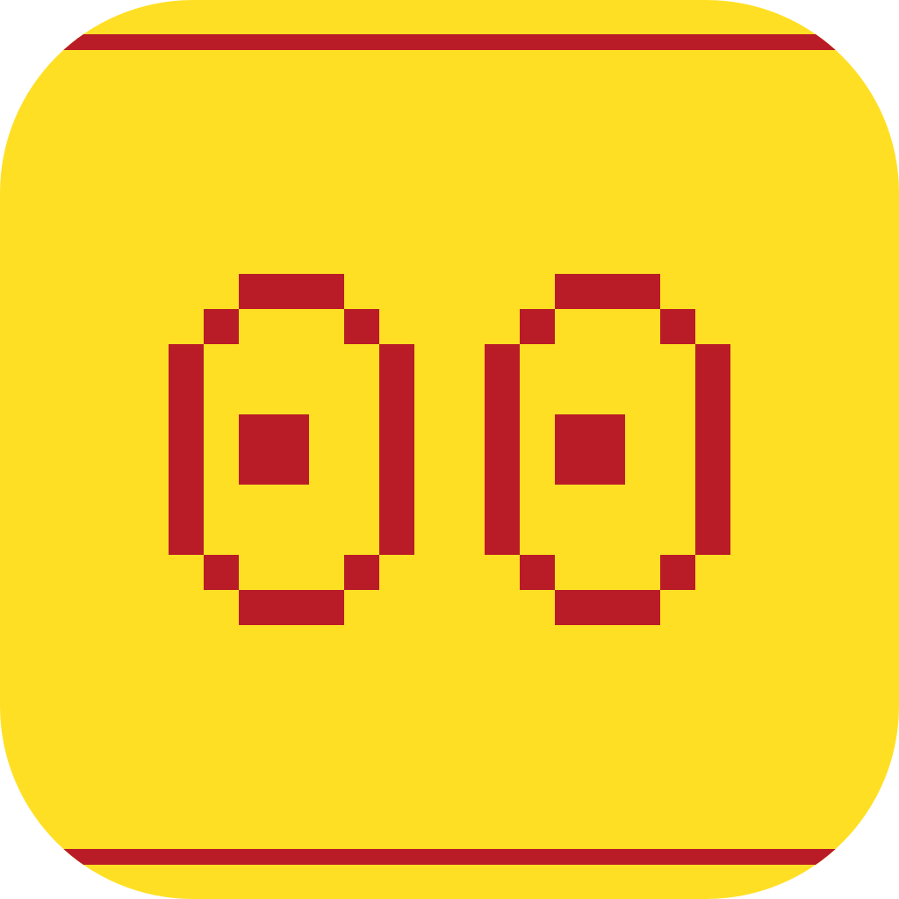

<div align="center">



<h1 id="dilated">Dilated</h1>

**Keeps your Mac awake. A native macOS 26 menu bar app for Apple Silicon.**

Timed holds, triggers, a CLI for agents, and an opt-in closed-lid mode.

</div>

<p align="center">
  <a href="https://dilated.codeswhat.com/download/file"></a>
  <a href="https://dilated.codeswhat.com/"></a>
  <a href="https://dilated.codeswhat.com/"></a>
  <a href="https://github.com/CodesWhat/dilated/releases"></a>
  <a href="https://codecov.io/gh/CodesWhat/dilated/branch/main"></a>
  <a href="LICENSE"></a>
</p>

<hr>

> [!IMPORTANT]
> **1.0.0-beta.10 is a public beta.** Closed-lid mode is experimental. If Dilated quits or stops responding during a closed-lid session, normal sleep comes back on its own. Reboot recovery hasn't been verified on hardware yet. Report problems on [GitHub](https://github.com/CodesWhat/dilated/issues).

<h2 align="center">Contents</h2>

- [Documentation](#documentation)
- [Quick Start](#quick-start)
- [Why Dilated](#why-dilated)
- [Features](#features)
- [Privacy and Permissions](#privacy-and-permissions)
- [Roadmap](#roadmap)
- [Build and Contribute](#build-and-contribute)
- [Support](#support)
- [Community and Support](#community-and-support)
- [Star History](#star-history)
- [CodesWhat Ecosystem](#codeswhat-ecosystem)
- [License](#license)

<hr>

<h2 align="center" id="documentation">Documentation</h2>

| Resource | Link |
| --- | --- |
| Website | [dilated.codeswhat.com](https://dilated.codeswhat.com/) |
| Download | [dilated.codeswhat.com/download/file](https://dilated.codeswhat.com/download/file) |
| Installation and removal | [docs/INSTALLATION.md](docs/INSTALLATION.md) |
| Automation (CLI, URLs, AppleScript, Shortcuts, triggers) | [docs/AUTOMATION.md](docs/AUTOMATION.md) |
| Architecture | [docs/ARCHITECTURE.md](docs/ARCHITECTURE.md) |
| Release procedure | [docs/RELEASING.md](docs/RELEASING.md) |
| Third-party notices | [docs/THIRD-PARTY.md](docs/THIRD-PARTY.md) |
| Releases | [github.com/CodesWhat/dilated/releases](https://github.com/CodesWhat/dilated/releases) |

<hr>

<h2 align="center" id="quick-start">Quick Start</h2>

Dilated needs **macOS 26 or later on Apple Silicon**. The current release is 1.0.0-beta.10, a public beta.

1. Download the signed, notarized DMG from [dilated.codeswhat.com](https://dilated.codeswhat.com/download/file).
2. Open the DMG, drag Dilated to Applications and open it.
3. Pick **Keep awake for** from the menu bar item.

Prefer Homebrew? `brew install --cask codeswhat/tap/dilated` installs the same build.

Closed-lid mode needs a narrow sudo rule that you install once with an administrator password. The [installation guide](docs/INSTALLATION.md) covers setup, crash recovery, updates and removal.

<hr>

<h2 align="center" id="why-dilated">Why Dilated</h2>

Sometimes a Mac needs to stay awake: a long build, a download, a backup, an agent working through a task. Dilated does that from the menu bar, and the [website](https://dilated.codeswhat.com/) has an interactive preview of the menu. You can hold for a set time or until you stop it, let a trigger do it when a condition is true, or call it from a script.

Battery floor and Low Power Mode guards can end a hold before it drains your battery, and Stop releases everything and pauses automation until you resume it. It's a beta, and closed-lid mode is the part with the least hardware testing.

<hr>

<h2 align="center" id="features">Features</h2>

| Area | What it does |
| --- | --- |
| **Holds and timers** | Timed and indefinite awake holds from the menu. Downloads can drive a hold too: choose **While a file downloads…** or **While a folder downloads…**, with 5 to 3600 seconds of inactivity before it ends. |
| **Display sleep** | Choose whether the display may sleep during a hold. |
| **Guards** | A battery floor (ignored on AC by default, configurable in **Settings → Battery & Safety**) and Low Power Mode guards. **Start Anyway** overrides the floor for one hold. Closed-lid has its own safety limits. |
| **Menu bar** | Four bundled glyphs, or your own static PNG icons (up to 512 × 512 pixels and 2 MB, separate idle image optional). Optional compact, clock or end-time text, with seconds shown or hidden, 12/24-hour choice and small or standard size. Indefinite holds show ∞. |
| **Triggers** | Named rules that keep the Mac awake while all their conditions match. Conditions: running or frontmost apps, processes, schedules, power, displays, network identity, Wi-Fi SSIDs, mounted volumes, USB and paired Bluetooth devices, selected audio output, CPU load and idle time. Dwell and grace delays. |
| **Automation** | URL scheme, AppleScript, four Shortcuts actions and a `dilated` CLI. The CLI covers `on`, `off`, `status`, `run -- <command>` and renewable agent holds (`hold`, `release`). Configurable global shortcuts. |
| **Drive Alive** | Opt-in. Writes a small hidden file to selected volumes at an interval you choose (30 to 3600 seconds) so they don't idle. It doesn't wake a sleeping Mac. |
| **Closed-lid mode** | Keeps the Mac running with the lid closed, through a sudo rule that lets Dilated run only `pmset -a disablesleep 0` and `1`. Admin accounts only. Experimental. A closed-lid trigger has to be armed each app run. |
| **Feedback** | Optional notification banners and sounds, both off by default. Local history and statistics. |

The [automation reference](docs/AUTOMATION.md) has every command, trigger condition and safety rule.

<hr>

<h2 align="center" id="privacy-and-permissions">Privacy and Permissions</h2>

- **Location** is requested only to match the Wi-Fi network names you choose for triggers. Dilated doesn't request or record your geographic location.
- **Bluetooth** is used only to match paired devices you choose for triggers. It doesn't scan for nearby devices or change their connections.
- **Closed-lid mode** needs the sudo rule at `/private/etc/sudoers.d/dilated`. Remove it any time with `dilated lid-permission remove` or `sudo rm /private/etc/sudoers.d/dilated`. If Dilated crashes, a watchdog restores sleep within seconds. A reboot without relaunching Dilated can leave sleep disabled until it next opens.
- **Notifications** are requested only when you enable banners.
- **Files** are accessed only through your selection, for example a download watch or a Drive Alive volume.

History and statistics stay on your Mac. The only network use in the app code is Sparkle's update check against `dilated.codeswhat.com`. There's no analytics code in it.

<hr>

<h2 align="center" id="roadmap">Roadmap</h2>

1.0.0 GA is gated on the hardware recovery checks listed in the [installation guide](docs/INSTALLATION.md#release-acceptance): sudo rule revocation and integrity, app crash recovery, reboot recovery, helper migration and the closed-lid transitions. Automatic agent setup is later work.

<hr>

<h2 align="center" id="build-and-contribute">Build and Contribute</h2>

Build the local app with `bash scripts/build-app.sh`, then open `build/Dilated.app`. This is a development build, not a notarized release. The script uses ad-hoc signing by default, and `DILATED_SIGN_IDENTITY` can select an installed signing identity. Xcode and XcodeGen are required. Real Shortcuts execution needs a developer-signed build on the tested Mac. An ad-hoc build can show up in the action catalog but fail to run.

`bash scripts/build-app.sh debug --verify` stops the running dev copy, rebuilds it, launches it and reports its PID. It refuses alternate output paths and waits for other Dilated copies to be quit first. Add `--logs` to stream app logs for five minutes after launch.

Set up the commit hooks once per clone:

```sh
brew install lefthook gitleaks && lefthook install
```

Run the checks with `bash scripts/verify.sh`. You need Xcode, XcodeGen, Python 3, Ruby and Node.js 24. It runs Swift tests, release packaging checks (including an isolated app build and launch), website tests, and formatting and syntax checks. CI uses the same entry point. After building the bundle, `python3 scripts/smoke-test.py` runs the bounded app and CLI integration check with disposable state.

The package app product and internal executable are named `DilatedApp` so they don't collide with the `dilated` CLI on case-insensitive macOS filesystems. The app users see is Dilated.

<hr>

<h2 align="center" id="support">Support</h2>

Dilated is free and open source. If it saves you time, you can support it on [GitHub Sponsors](https://github.com/sponsors/CodesWhat) or [donate directly](https://codeswhat.com/support).

<hr>

<h2 align="center" id="community-and-support">Community and Support</h2>

Open an [issue](https://github.com/CodesWhat/dilated/issues) for bugs. Include the Dilated and macOS versions and steps to reproduce. Report security problems through GitHub's [private vulnerability reporting](https://github.com/CodesWhat/dilated/security/advisories/new), not in a public issue.

<hr>

<h2 align="center" id="star-history">Star History</h2>

<div align="center">
  <a href="https://www.star-history.com/#CodesWhat/dilated&Date">
    <picture>
      <source media="(prefers-color-scheme: dark)" srcset="https://api.star-history.com/chart?repos=codeswhat/dilated&type=date&legend=top-left&theme=dark" />
      <source media="(prefers-color-scheme: light)" srcset="https://api.star-history.com/chart?repos=codeswhat/dilated&type=date&legend=top-left" />
      
    </picture>
  </a>
</div>

<hr>

<h2 align="center" id="codeswhat-ecosystem">CodesWhat Ecosystem</h2>

<table>
  <tr><th>Tool</th><th>Role</th></tr>
  <tr><td><b>dilated</b></td><td>Keeps your Mac awake. Menu bar app with triggers and a CLI</td></tr>
  <tr><td><a href="https://github.com/CodesWhat/mouthtype"><b>mouthtype</b></a></td><td>Local dictation for Mac. Hold Fn, speak, release to paste</td></tr>
  <tr><td><a href="https://github.com/CodesWhat/drydock"><b>drydock</b></a></td><td>Container update monitoring, web UI and notification engine</td></tr>
  <tr><td><a href="https://github.com/CodesWhat/portwing"><b>portwing</b></a></td><td>Remote Docker agent, secure socket-level access from Drydock or standalone</td></tr>
  <tr><td><a href="https://github.com/CodesWhat/sockguard"><b>sockguard</b></a></td><td>Docker socket proxy, default-deny allowlist filter protecting the socket</td></tr>
</table>

Dilated and Mouthtype are the two desktop apps here. The other three tools are for Docker hosts.

<hr>

<h2 align="center" id="license">License</h2>

Dilated is licensed under [MIT](LICENSE). Dependencies have their own terms, recorded in [docs/THIRD-PARTY.md](docs/THIRD-PARTY.md).

[CodesWhat](https://codeswhat.com): small, sharp tools from one developer and a lot of agents.

<div align="center">
  <a href="#dilated">Back to top</a>
</div>
